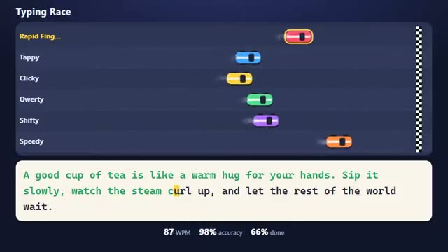

# Typing Race

Type the passage. Your car moves as you type. A multiplayer starter game from [Multiplayer Agent](https://multiplayeragent.com): 2D, versus, 2–8 players, with bots that fill empty seats.

## How it plays

Everyone types the same passage, and every right letter moves your car. A wrong key stops you until you type the right one. First to finish wins.

**Controls:** Keyboard, or your phone's keyboard.

## Make it yours in the Game Builder

Open the [Game Builder](https://multiplayeragent.com), choose **Start from a starter game** and pick Typing Race. It opens as version 1 in your studio, ready to play and publish. Then ask for changes, for example:

- Use passages from famous books
- Add a mode where you type code
- Add a boost for 10 words without a mistake

## Run it yourself

1. Get a free publishable key (`pk_…`) at [multiplayeragent.com](https://multiplayeragent.com).
2. In `index.html`, put it in place of `pk_REPLACE_ME` in the `MP_CONNECT` block.
3. Open `index.html` in a browser. No build step and no server needed.

Without a key it still runs, offline against bots.

## How it is built

- One `index.html`. The comment at the top of the script maps the code and explains the multiplayer. The passages are a plain list in `CONFIG.passages`: add your own.
- **Leaderboard:** Each player's best words per minute.
- **Host-run rounds:** One player's browser picks the passage, counts down and posts the results; if it leaves, the next player takes over.
- **Bots:** Typing bots race at different speeds, mistakes and all, until enough people join.
- **Live sync:** Every car moves for everyone as its player types.
- `?attract` runs it offline: your car types itself against bots. The preview video is recorded from it.

## License

MIT.
